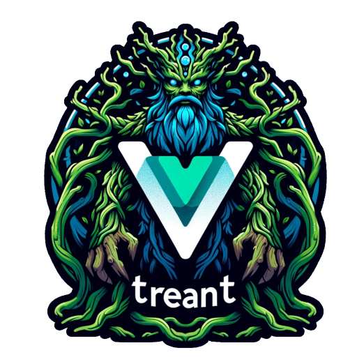

[](https://www.npmjs.com/package/vue-treant)
[](https://www.npmjs.com/package/vue-treant)

# Vue Treant

Vue Treant is a Vue 3 component designed to create and display hierarchical tree structures. It supports recursive rendering of nodes, making it perfect for visualizing entity relationships, organizational charts, or any nested data structure.

## Features

- Recursive Rendering: Supports infinite levels of nesting for nodes.
- Dynamic Expansion: Nodes can be expanded or collapsed dynamically.
- Customizable: Easily customize node appearance and behavior using slots and props.
- Event Handling: Emits events for node expansion and activation.

## Installation

To install Vue Treant:

```bash
yarn add vue-treant
```

## Usage

Here's a basic example of how to use Vue Treant in your Vue 3 project.

### Basic Usage

```vue
<script setup lang="ts">
import { ref } from 'vue';
import VueTreant from 'vue-treant';
import type { Node } from 'vue-treant';

const treeData: Node[] = [{
  title: 'Root',
  id: 'root',
  children: [
    {
      title: 'Node 1',
      id: 'node_1',
      children: [
        { title: 'Node 1.1', id: 'node_1_1' },
        { title: 'Node 1.2', id: 'node_1_2', children: [{ title: 'Node 1.2.1', id: 'node_1_2_1' }] },
      ]
    },
    {
      title: 'Node 2',
      id: 'node_2',
      children: [
        { title: 'Node 2.1', id: 'node_2_1' },
        { title: 'Node 2.2', id: 'node_2_2' }
      ]
    }
  ]
},
{ title: 'Other', id: 'other' }
]
</script>

<template>
  <VueTreant :data="treeData" />
</template>
```

You can also use `:node` instead of `:data` for backward compatibility.

## Props

- `data` or `node`: `Node[]` - Array of tree nodes
- `contextMenu`: `any[]` (optional) - Context menu items

## Events

### onNodeExpand / node-expand

- **Event Name:** `on-node-expand` (or `node-expand`)
- **Description:** Emitted when the expand/collapse control is clicked.
- **Payload:** `(nodeId, isExpanded)`

### onNodeActivate / node-activate

- **Event Name:** `on-node-activate` (or `node-activate`)
- **Description:** Emitted when the node checkbox is toggled.
- **Payload:** `(nodeId, isActive)`

## Node Structure

```ts
interface Node {
  title: string;
  id?: string;
  children?: Node[];
  expanded?: boolean;
  active?: boolean;
  context?: any;
}
```

## Contribute

[](https://ko-fi.com/O5O8X9SD)
